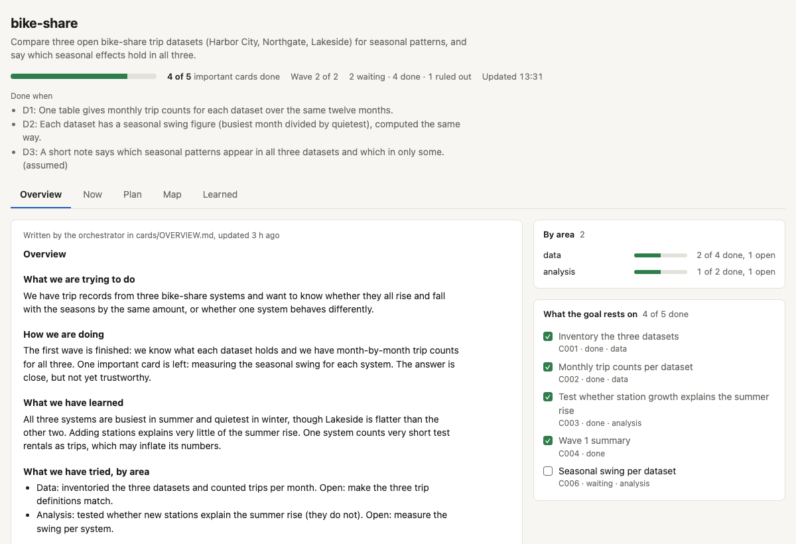

# cardhand

Run any job as a queue of cards. A fresh agent does one card, writes the result to disk, and exits.
The queue grows as the work teaches you things.

Install it in Claude Code:

    /plugin marketplace add rajaxar/cardhand
    /plugin install cardhand@cardhand

Then, in any folder:

    /cardhand:start find out why our nightly export is slow    # one-line idea: it posts its plan and starts
    /cardhand:start specs/migration.md                         # you already have a spec: it slices it into cards
    /cardhand:run                                              # works the queue; run it again after a break or in a new session
    /cardhand:status                                           # what needs you, what is running, what was learned



*The dashboard's Overview tab, from `examples/bike-share/` (invented data).*

You get a `cards/` folder: a brief, one Markdown file per card, and generated views. Close the laptop.
Next week, `/cardhand:run` reads the files and carries on.

## Try it in 30 seconds, no model needed

The example is a finished first wave of a small data job. In a clone of the repo, copy it to a scratch folder,
let the script build the views, and open the dashboard:

    git clone https://github.com/rajaxar/cardhand && cd cardhand
    cp -R examples/bike-share /tmp/bike-share
    python3 skills/start/scripts/cards.py --dir /tmp/bike-share/cards status
    open /tmp/bike-share/cards/dashboard.html        # xdg-open on Linux

This runs only the standard-library script. It calls no model and costs no credits.

**Best for:** research, data digging, long jobs where the plan changes as you learn.
**Not for:** one-shot edits (just ask), and pure feature work where a coding-methodology plugin already fits.
**No required process.** Cards need no reviews, specs or phases. Add checks where a job needs them.
**No runtime beyond Python 3** (standard library) for the queue script. Without it, the files can be edited by hand.

## Where it runs

cardhand runs in Claude Code, Codex CLI, Cursor and Copilot CLI. Each loads the same `skills/` tree from the portable
`plugin.json`, and `skills/run/references/harness.md` tells the orchestrator how to start and watch a fresh worker on
that harness. OpenCode and any harness that edits files can run the queue from a clone: the cards and the script are the
protocol.

    # Codex CLI
    codex plugin marketplace add rajaxar/cardhand
    codex plugin add cardhand

In Cursor or Copilot CLI, add `rajaxar/cardhand` as a plugin marketplace and install `cardhand`. For development, use
`claude --plugin-dir /path/to/plugin`.

## What a card looks like

A card is a Markdown file. This one is from `examples/bike-share/`, with the bookkeeping fields trimmed:

```
---
id: C002
title: Monthly trip counts per dataset
status: done
depends_on: [C001]
spawned_by: human
---
## Do
Count trips per month for each dataset over the shared twelve months, and put them in one table.
## Result
Every dataset has its busiest month in summer and its quietest in winter, though Lakeside is flatter than the other two.
## Proposed cards
- Align the trip definition across datasets (Northgate counts short test rentals).
```

The worker wrote the Result and the proposal. The orchestrator read the Result, accepted the card, and filed the
proposal as a new card (`C005`, which says `spawned_by: C002`). Line 1 of a Result is the answer, in one sentence.
The full folder, including a dropped card and a "Ruled out" answer, is in `examples/bike-share/`.

## Two ways to start

| You have | You type | It does |
|---|---|---|
| One line | `/cardhand:start compare three bike-share datasets for seasonal patterns` | Reads what it can, posts one screen (how it read the ask, the first version, assumptions, the first wave), then starts the first wave in the same turn. It does not wait for a reply and asks no questions first. Redirect it at any time |
| A spec, checklist or task list | `/cardhand:start specs/migration.md` | Makes one card per open item, keeps the source as an input, and starts |

A tiny job is done directly, with one sentence and no files. Say "cards" if you want it tracked anyway.

## What it creates

One `cards/` folder: `BRIEF.md` and `RULES.md` (the plan and the rules), `OVERVIEW.md` (the plain-words big picture), one
Markdown file per card in `queue/`, one output folder per card in `scratch/`, `cards.py` (the queue script), and a
self-refreshing `dashboard.html`. `STATUS.md`, `status.json`, `status.js` and `view/` are generated. Commit the Markdown
and `scratch/`; ignore the generated files.

Add your own rules at the bottom of `RULES.md`. One line turns on a test gate, for example `check_cmd: pytest -q`. For
independent re-checks, copy `recipes/checks.md` to `cards/recipes/checks.md` and add the line it shows.

## How the queue works

A card is ready when everything in `depends_on` is done or dropped. Ready cards run by priority, then oldest first. A
worker can propose a new card and the orchestrator files it, so the queue grows from the work. Work moves in waves: at
the end of a wave the orchestrator posts what works and starts the next.

## The cost

Idle, the plugin adds about 680 bytes of skill names and descriptions, about 170 tokens. A skill body loads only when you
use it.

One card dispatch reads about 3.3 KB of the plugin's own text: the prompt, `RULES.md`, the card and its inputs. That is
about 830 tokens. Your own card inputs are extra and can be larger.

## Where it fits

| Tool kind | What they do well | Where cardhand differs |
|---|---|---|
| Long chat sessions | Everything in context, nothing to set up | cardhand keeps the plan in project files, not in the chat |
| Methodology plugins for coding | Plans, test-first, review, polished skills | cardhand has no required process and is not tied to software |
| Task-graph tools | Many concurrent agents, atomic claims | cardhand is Markdown plus one script, with no database |
| Native agent task lists | Built in, with dependencies | cardhand is plain files that are meant to outlast a session |

## Without the plugin

`python3 cards/cards.py --help` lists the commands: `init`, `new`, `depend`, `ready`, `claim`, `result`, `accept`,
`reject`, `retry`, `answer`, `drop`, `priority`, `check`, `status`. You can run the queue by hand with them, or use just
the script and the card files.

## Run the checks

    PYTHONDONTWRITEBYTECODE=1 python3 tests/check.py

Seven free checks: a throwaway queue lifecycle, lints, name and version, idle-size budget, no stray files, and
`claude plugin validate` locally. No model is called. Every push runs the free checks in CI.

[](https://github.com/rajaxar/cardhand/actions/workflows/checks.yml)

## License, changelog

MIT (see `LICENSE`). Changes: see `CHANGELOG.md`. Bugs and ideas: open an issue and say which harness and version you ran.
